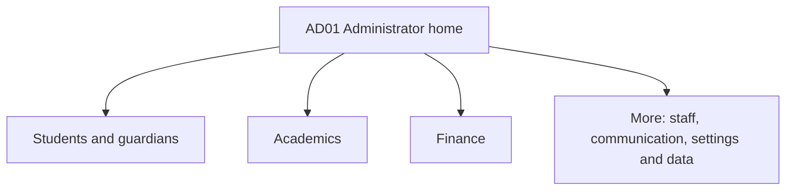

# EduCore final administrator specification

Version 1.0 | 29 October 2026 | Final administrator implementation scope

Secondary schools only: JSS1-JSS3 and SSS1-SSS3. Use this as the authoritative administrator scope. React Native with Model-View-Presenter, Java microservices and SQL remain selected. Other role pages are named as dependencies; their complete interfaces are separate planning work.

34 page templates. Edit/create modes, stepped forms, inline previews and dialogs share their route template. The selected school day ends at 13:00 on every normal teaching day.

## Navigation

Home / Students / Academics / Finance / More

| Area | Pages |
| --- | --- |
| Home | AD01 |
| Students and families | AD02, AD03, AD04, AD05, AD06 |
| Teachers | AD07, AD08, AD09 |
| School and academic planning | AD10, AD11, AD12, AD13, AD14, AD15 |
| Attendance results and reports | AD16, AD17, AD18, AD19, AD20 |
| Finance | AD21, AD22, AD23, AD24, AD25 |
| Promotion and completion | AD26, AD27 |
| Communication and complaints | AD28, AD29, AD30, AD31, AD32 |
| Data and history | AD33, AD34 |

## Adopted decisions

### Scope

Secondary schools only: JSS1-JSS3 and SSS1-SSS3, with class arms and SSS subject pathways. One school is used for the presentation. Each school keeps isolated records and supported settings.

### School day

Monday-Friday; academic timetable 08:00-13:00 WAT. This interprets the requested 1 p.m. closing time as applying to every teaching day. Start time 08:00 is the selected presentation default.

### Periods and break

Use 30-minute base periods and 60-minute double lessons. Break is locked daily from 11:30 to 12:00. A lesson can end at 11:30 or start at 12:00; it cannot cross the break.

### PT and sport

Wednesday PT is an option, enabled for presentation at 08:00-08:30. Friday sports is reserved at 12:00-13:00. These are school activity blocks with supervisors, not replacements for a curriculum subject.

### Term calendar

One academic session contains First, Second and Third Term. School staff enter actual dates from the applicable approved state/school calendar; the app does not invent a single nationwide date set.

### Timetable membership

Class arm plus relevant subject-group membership determines the student timetable. Teachers see their combined assigned lessons. Guardians see the selected child timetable. Publication has a version and effective date.

### Attendance

One daily register per class from its attendance teacher, expected by 08:30. Admin totals and absence follow-up use submitted registers. Parent absence alerts follow office review; missing registers never count as absent students.

### Attendance follow-up

PRESENT, ABSENT, LATE and EXCUSED are distinct. Office staff records reasons/corrections. Three absences in ten teaching days raises a follow-up flag without automatic punishment.

### Internal assessment

For the presentation school: CA1 20 plus CA2 20 plus term examination 60 equals 100. Bands: A >=70, B >=60, C >=50, D >=45, E >=40, F <40. This internal policy is separate from official external-exam scoring.

### Report publication

Teachers submit marks; class teacher completes remarks and ratings; Principal approves/publishes. Missing required marks block publication. Reports show scores, grades, average, attendance and remarks; overall class ranking is omitted. Late arrivals count as days present but remain separately labelled. If registers are incomplete, attendance coverage is labelled incomplete and no misleading full-term percentage is printed.

### Promotion

Annual mean >=50, English and Mathematics each >=40, and >=60 percent of enrolled subjects passed at >=40. Use published terms; missing terms or changed subject combinations require review. Principal can record reasoned exceptions.

### Completion

JSS3 stage completion and SSS1 pathway placement receive explicit review. SSS3 graduation is Principal-approved school completion. Official BECE/WAEC/NECO results are stored as issued, not calculated or certified by EduCore.

### Fees

NGN invoices by class/term with optional individual charges; part payment enabled. Issued charges remain stable; approved credits, discounts, payments and refunds change balances through recorded actions. Fee debt is not an automatic academic block.

### Payment provider

Select Paystack hosted checkout, initialised and verified by Java backend. Parent sees pending/confirmed/failed status and receipt. School settlement setup is configured separately. Cash and independently verified bank payments can be recorded by Accounts staff.

### Guardian accounts

Enrolment creates or links the guardian account and child relationship. Phone is required; email may be supplied later. Activation uses verified email or private one-time instructions delivered by school. Collect payer email at Paystack payment time if missing.

### Communications

In-app notices/messages/cases plus push are the main delivery. Verified email is used for activation/recovery, confirmed payment receipts, important calendar notices and complaint acknowledgement/resolution. This scope does not require SMS, WhatsApp, public group chat or voice/video.

### Complaints

Guardian app submission and office-recorded walk-in/phone cases. Categories: fees, attendance, academic records/results, staff conduct and general. Authorised owner, two-teaching-day first-response target, parent replies, internal notes and reasoned closure.

### Permissions

One administrator interface with Principal, School Office and Accounts permission presets. Teachers, students and parents keep their own role interfaces. Principal owns administrative privilege changes and final academic publication/promotion.

### Data transfer

CSV imports for students/guardians, teachers/assignments and reviewed opening balances. Validation and duplicate preview precede confirmation. PDF reports and CSV row exports respect selected school, filters and permissions.

### Changes and history

Submitted attendance, published results, confirmed payments, approved promotion and access changes record actor, time, reason and versions. The app offers controlled correction/reversal and read-only history rather than destructive record removal.

## Daily timetable template

| Time WAT | Monday Tuesday Thursday | Wednesday | Friday |
| --- | --- | --- | --- |
| 08:00-08:30 | Lesson 1 | PT when enabled | Lesson 1 |
| 08:30-09:00 | Lesson 2 | Lesson 2 | Lesson 2 |
| 09:00-09:30 | Lesson 3 | Lesson 3 | Lesson 3 |
| 09:30-10:00 | Lesson 4 | Lesson 4 | Lesson 4 |
| 10:00-10:30 | Lesson 5 | Lesson 5 | Lesson 5 |
| 10:30-11:00 | Lesson 6 | Lesson 6 | Lesson 6 |
| 11:00-11:30 | Lesson 7 | Lesson 7 | Lesson 7 |
| 11:30-12:00 | BREAK | BREAK | BREAK |
| 12:00-12:30 | Lesson 8 | Lesson 8 | SPORTS |
| 12:30-13:00 | Lesson 9 | Lesson 9 | SPORTS |

Wednesday PT is optional and enabled for presentation. Official examination days can use Principal-approved dated exceptions with reasons and notification; ordinary lessons respect the normal break and activity blocks.

## Reports

| Report | Contents | Audience and format |
| --- | --- | --- |
| Student term report | School/student identity; admission no; session/term; class arm/pathway; subjects with CA1, CA2, exam, total, grade; average; school days held, present/absent/late/excused; class-teacher and Principal remarks; ratings; next resumption date; publication revision. | Student Report card and Parent Child report card; PDF. |
| Class academic broadsheet | Each student with subject totals/grades, completeness indicators, term average and class/subject summary. No comparison across incompatible subject combinations. | Principal and authorised academic staff; CSV/PDF. |
| Attendance report | Registers expected/submitted/missing, daily counts, student totals, date range and follow-up flags. A missing register is reported as incomplete information. | School Office/Principal; parent sees only child records; CSV/PDF. |
| Finance report | Issued charges, credits, confirmed payments by method, remaining balances, arrears, refund status and reconciliation exceptions. | Accounts/Principal; guardian sees only authorised child invoices/receipts; CSV/PDF. |
| School administration report | Enrolment by class/pathway/status, teacher assignments and outstanding duties, promotion outcomes and complaint backlog/response ages. | Principal and authorised office staff; CSV/PDF. |

Report-card ratings: Conduct, Punctuality, Cooperation, Handwriting and Practical skills. Scale: 1 needs improvement, 2 developing, 3 satisfactory, 4 good, 5 excellent. No overall class ranking.

## Permissions

| Operation | Principal | School Office | Accounts |
| --- | --- | --- | --- |
| School settings and administrator access | Manage | Read relevant school settings | Read finance settings |
| Students and guardians | Manage and authorise | Enrol, update, link and invite | Read payer/invoice context |
| Teachers and assignments | Manage/deactivate | Register and maintain permitted teaching assignments | No teaching administration |
| Calendar and timetable | Approve and publish | Prepare calendar/timetable drafts | Read calendar |
| Attendance | Review and correct with reason | Follow up and correct with reason | No general register access |
| Assessment/results/report cards | Set policy, approve and publish | Prepare cycles, review completeness, request corrections | No marks access |
| Invoices and manual payments | Manage and review | Read permitted fee status only | Issue, verify/manual-record, reconcile |
| Credit/discount/refund | Approve, with reason | No financial adjustment | Prepare/request; execute after approval |
| Promotion/graduation | Approve and confirm | Prepare preview and resolve records | Read financial arrears separately |
| Announcements/messages | Publish and participate | Publish authorised notices; office inbox | Finance threads/notices only |
| Complaints | All authorised cases; staff-conduct owner | General/attendance/records cases | Finance cases only |
| Imports/exports/history | Approve balances; full permitted school audit | Student/teacher imports and academic/office exports/history | Finance imports/exports/history |

## Connections to other role pages

| Connection type | Source | Destination | Behaviour |
| --- | --- | --- | --- |
| Shared source record | Enrolment/guardian/teaching assignment save | Teacher My classes/roster; Student class; Parent linked Children | Views read accepted school records. A new child/teacher is not manually copied into each role page. |
| Draft then publication | Calendar/timetable approved with effective date | Teacher timetable; Student timetable; Parent Child timetable/calendar | Old version stays visible until publication becomes effective; notify the affected audience. |
| Teacher submission | Teacher saves and submits daily register | AD16 overview and AD17 register | Drafts remain unsent; submitted rows feed absent/late totals and follow-up. |
| Reviewed parent alert | Office confirms an absence or material correction | Parent Child attendance and Notifications; Student attendance | Per-child notification; read state and delivery failures are visible to authorised staff. |
| Academic review and publication | Teacher marks -> class-teacher remarks -> Principal approval | Student Results/Report card; Parent Child results/Report card | Family views receive only published versions; correction republishes a new revision. |
| Verified financial update | Guardian checkout or Accounts-confirmed manual funds | Parent Invoice/Payment status/Receipt; AD23-AD25 | Backend-confirmed money updates one allocation; pending checkout is not a paid invoice. |
| Authorised conversation | Parent/staff accepted message | Parent Conversation; Teacher Conversation; AD29-AD30 | Same thread record with current participant checks and push notification. |
| Tracked case | Guardian complaint -> assigned admin -> resolution | Parent My complaints/Case detail; AD31-AD32 | Parents see case replies/status; authorised staff see internal notes. Teacher input is requested through Messages. |
| Confirmed year transition | Principal-confirmed promotion/completion | Teacher next-session roster; Student and Parent class/history/timetable | History stays in source year; target membership is created once and becomes current with target session. |

## Workflows

### School setup and calendar

AD10 -> AD11 -> AD12 -> AD08/AD09 -> AD13

1. Principal confirms school settings and staff permissions. Office creates the session and three terms, using approved dates.

2. Add holidays, mid-term break, examinations/open day and resumption. Non-teaching days produce no lessons or expected daily register.

3. Apply the period template, break, Wednesday PT option and Friday sports. Assign activity supervisors.

4. Configure class arms, SSS pathways, core/choice subjects and weekly targets; register teachers and actual teaching assignments.

5. Publish calendar and reviewed timetable; notify affected teachers, students and guardians.

### Enrolment and continuing students

AD02 -> AD03 -> AD04 -> AD13

1. Search for existing child/guardian before creating records. Validate identity, class, conditional SSS department, guardian relationship and school-required fields.

2. Reject restricted fresh SSS3 entry for sessions from 2026/27; distinguish documented legacy migration from a fresh admission.

3. Create or resume the stable student and dated enrolment; create/link guardian account after school authorisation; assign core/selected subject groups.

4. Student joins matching class/subject timetable and teacher rosters. Guardian receives activation instructions if needed. Show component status and admission number.

5. Existing profile supports dated class moves, records/guardian updates and withdrawal. Earlier academic and financial history is retained.

### Attendance and absence follow-up

Teacher register -> AD16 -> AD17 -> Parent attendance

1. Attendance teacher loads dated roster, marks PRESENT/ABSENT/LATE/EXCUSED, saves draft and submits by the expected morning deadline.

2. After accepted submission, admin overview displays counts and named absent/late students. Missing submissions are a separate queue.

3. Office checks absence reasons and approves individual guardian alerts. Guardian opens authenticated child attendance or replies through the linked school message.

4. Office records any correction with reason/current version; affected parent receives correction update when needed. Repeated absence raises follow-up only.

5. Attendance reports use actual teaching days and show register completeness so missing data never becomes a false absence percentage.

### Assessment and report publication

AD18 -> Teacher marks/comments -> AD19 -> AD20 -> Family results

1. Principal locks the internal policy before mark entry. Office sets class/term assessments and deadlines.

2. Assigned teachers enter CA1, CA2 and examination marks; submit their accepted versions. Class teacher provides remarks and five ratings: conduct, punctuality, cooperation, handwriting and practical skills (1 needs improvement to 5 excellent).

3. Admin reviews completeness, score ranges and unresolved absences; returns errors to the responsible teacher. A make-up or approved zero for absence is explicitly recorded.

4. Principal approves/publishes the class-term batch. Generate report PDFs and notify students/guardians.

5. Report corrections reopen the relevant scope and create a new published revision. Official external examination data remains separately labelled and recorded as issued.

### Fees payments and reconciliation

AD21 -> AD22/AD23 -> Parent checkout -> AD24/AD25

1. Accounts drafts class/term fee plans. Preview students and line items, then issue immutable invoice snapshots once.

2. Guardian pays permitted full/partial amount through Paystack hosted checkout. Backend binds school invoice/settlement, creates attempt and verifies the outcome.

3. Show pending until verified. Confirmed payment updates invoice allocation and receipt. For cash/manual bank funds Accounts verifies before recording confirmation and proof/reference.

4. Review provider settlement matches and exceptions. Keep mismatches visible until evidence-backed resolution.

5. Accounts requests credit/discount/refund; Principal approves. Track resulting ledger/provider outcome and preserve original records.

### Promotion and graduation

AD26 -> AD27 -> Next-session class views

1. After published Third Term, prepare annual subject/term averages and proposed outcomes using the selected school rule.

2. Review missing terms, new subject combinations and transfer records. Principal records any exception with reason.

3. JSS1/JSS2/SSS1/SSS2 advance or repeat as approved. JSS3 stage outcome is reviewed; continuing students need SSS1 pathway/subject choices. SSS3 completion is approved by Principal.

4. Confirm the reviewed batch once. Track per-student completion/failure. Create target enrolments once, retaining source-year history.

5. New teachers/classes see the resulting roster when the target session becomes active. Unpaid old invoices remain outstanding rather than being deleted or duplicated.

### Communication and complaints

Parent/Office -> AD28-AD32 -> Authorised recipient

1. Publish scoped notices to school/class/department audiences. Use in-app content plus push; important calendar notices can email verified contacts.

2. Parent messages eligible class teacher or school office in a child-linked thread. Replies and accepted attachments remain in the authenticated app.

3. Guardian submits formal complaint, or Office records a walk-in/phone complaint. Assign an authorised owner; staff-conduct cases route to Principal.

4. Track NEW -> IN_REVIEW -> WAITING_FOR_PARENT as needed -> RESOLVED -> CLOSED. Parent can accept resolution or request review. Internal notes are not shown to parent.

5. Acknowledge promptly; target first response within two teaching days. Deliver case status by in-app/push and verified-email acknowledgement/resolution. Do not close solely due to inactivity.

### Imports exports and history

AD33 -> Validation/confirmation -> Accepted records -> AD34

1. Download CSV template for students/guardians, teachers/assignments or opening finance balances.

2. Map fields, validate values, preview duplicate matches and show row errors. Correct errors before confirming the selected import scope.

3. Record accepted per-row outcomes with batch/reference; retry only failed work without duplicate accepted records. Principal approves opening balance entries.

4. Export authorised filtered row data as CSV and documents as PDF, with school, session/term, generated time and appropriate identity.

5. Record actor/time/reason and allowed before/after values in read-only history. Secrets and raw payment credentials are excluded from displayed history.

## Final page specifications

### AD01 Administrator dashboard

Layout: dashboard

**Visible content**

- School, session, term and date

- Register completion; absent and late totals from submitted registers

- Pending marks, results approval, payment exceptions and unresolved complaints

- Today's lessons, PT, sports and calendar exceptions

**Actions**

- Open an actionable count

- Enrol student

- Open the relevant work queue

**Rules and states**

- Totals respect school and staff permissions

- Missing registers stay separate from absence counts

- Finance tiles require finance access

**Connections to other roles**

- Teacher home: outstanding registers and mark submissions

- Parent/student home: published updates

Related administrator pages: AD02, AD16, AD19, AD24, AD31

Wireframe labels: Current session and term / Registers submitted / Missing / Absences / Late arrivals / Results and payment exceptions / Open work queue

### AD02 Students directory

Layout: list

**Visible content**

- Name, admission number, class arm, SSS department and status

- Search plus session, class and status filters

- Class roster shortcut and import link

**Actions**

- Enrol student

- Open existing student

- Open class roster

- Export authorised filtered list

**Rules and states**

- One stable student record across years

- Include inactive records only when filtered

- New SSS3 entry restriction applies from 2026/27

**Connections to other roles**

- Teacher class roster receives active enrolled students

- Parent Children list receives verified links

Related administrator pages: AD03, AD04, AD13, AD33

Wireframe labels: Search admission number or name / Session / Class / Department / Student rows and status / Enrol student

### AD03 Student enrolment and edit form

Layout: form

**Visible content**

- Full name, birth date, residential address, admission date; photograph and supporting documents as configured

- Current session, class arm and conditional SSS department

- Guardian name, relationship, required phone, email if available and verified existing account match

- Subject choices, required school fields and review step

**Actions**

- Save local draft

- Validate and enrol

- Edit allowed student details

- Print admission and activation slip

**Rules and states**

- One confirmed action creates/resumes student, enrolment, guardian link, subjects and appropriate roster membership

- Guardian account is created pending activation or linked after school authorisation

- Admission number is generated; migrated admission numbers are preserved

- New external SSS3 admissions are blocked for 2026/27 onward; same-school promotion is separate

**Connections to other roles**

- Parent activation then Children and Child overview

- Student home and timetable

- Teacher class roster

Related administrator pages: AD02, AD04, AD06, AD13

Wireframe labels: Student identity / Session and class arm / SSS department if required / Guardian and account match / Subject choices and documents / Review and enrol

### AD04 Student profile

Layout: detail

**Visible content**

- Identity, current class/department and enrolment status

- Tabs: Overview, Guardians, Enrolment history, Learning, Attendance, Fees, Documents and History

- Published results, assignment submission status, complaint references and stage-exam records

**Actions**

- Edit details

- Transfer class/arm with effective date and reason

- Invite student account if school enables it

- Record withdrawal

- Open authorised attendance, invoice, report or complaint

**Rules and states**

- Prior classes, marks, attendance, invoices and authorship remain intact

- Class changes update future subject/timetable membership

- Learning oversight does not allow administrator impersonation of student submissions

- External exam records are official values or attached documents, not generated certificates

**Connections to other roles**

- Student Profile, Timetable, Attendance, Results

- Parent Child overview, Fees, Reports

- Teacher Student learning profile

Related administrator pages: AD03, AD06, AD17, AD20, AD23, AD32

Wireframe labels: Student and class / Guardians / Enrolments / Learning / Attendance / Fees / Documents / History / Open related record

### AD05 Parents and guardians directory

Layout: list

**Visible content**

- Guardian name, masked registered contacts, linked children and activation state

- Search by name, phone, email or child

- Filters for invitation pending and inactive links

**Actions**

- Open guardian

- Add authorised guardian and child link

- Resend activation from profile

**Rules and states**

- One guardian account can serve several children and schools

- School view exposes only its own child relationships

- Matching contact text does not itself grant access

**Connections to other roles**

- Parent account and Children selector

Related administrator pages: AD06, AD04

Wireframe labels: Search guardian or child / Contact and activation status / Linked children / Open guardian

### AD06 Guardian profile and link editor

Layout: form

**Visible content**

- Guardian contacts and account activation state

- School-linked children, relationship, primary-contact and payer flags

- Invitation history and record changes

**Actions**

- Add/revoke a child relationship

- Update permitted contacts

- Send or replace invitation

- Print one-time activation instructions

- Open child profile

**Rules and states**

- Revocation ends future access without deleting history

- Portal activation uses verified email or a private one-time code delivered by school

- Phone is required; email can be supplied later

- Reissuing invitation invalidates previous unused invitation

**Connections to other roles**

- Parent activation, Profile and Children pages

- Teacher eligible family-message recipients

Related administrator pages: AD05, AD04

Wireframe labels: Guardian and contacts / Linked children and permissions / Activation status / Add or revoke child link / Save changes

### AD07 Teachers directory

Layout: list

**Visible content**

- Name, staff number, active state and invitation state

- Assigned subjects, class arms and class-teacher responsibility

- Search and subject/class/status filters

**Actions**

- Register teacher

- Open teacher

- Open import teachers

**Rules and states**

- School membership and historical staff authorship are retained after deactivation

- Office can assign teacher access but cannot grant principal or accounts privileges

**Connections to other roles**

- Teacher activation and My classes

Related administrator pages: AD08, AD09, AD33

Wireframe labels: Search teacher / Subject / Class / Status / Staff and assignment summary / Register teacher

### AD08 Teacher registration and edit form

Layout: form

**Visible content**

- Name, staff number, contact, joining date and employment state

- Subjects and levels eligible to teach

- Actual class-arm/subject assignments and effective session or dates

- Availability and optional class-teacher/attendance duty

**Actions**

- Save teacher

- Invite existing or new account

- Save actual teaching assignments

**Rules and states**

- Can teach and assigned to teach are separate fields

- Each active class-subject has one primary assigned teacher; substitutes are dated changes

- Duplicate staff numbers are rejected

- No payroll or recruitment workflow is added

**Connections to other roles**

- Teacher My classes, Timetable and Attendance responsibility

Related administrator pages: AD07, AD09, AD13

Wireframe labels: Staff identity and contact / Eligible subjects and levels / Actual classes and subjects / Availability and attendance duty / Save and invite

### AD09 Teacher profile and assignments

Layout: detail

**Visible content**

- Staff contact, account state and invitation history

- Assigned classes, subjects, schedule and attendance duty

- Missing registers, unsubmitted marks and assignment review totals

**Actions**

- Edit assignments with effective dates

- Reassign active work

- Deactivate/reactivate school access

- Open combined timetable

**Rules and states**

- Deactivation ends access and requires an active-work handover

- Past marks, attendance and feedback retain original authors

- Teaching assignment does not grant finance access

**Connections to other roles**

- Teacher dashboard, My classes, Timetable and mark-entry screens

Related administrator pages: AD08, AD13, AD14, AD16, AD19

Wireframe labels: Teacher and account state / Classes and subjects / Timetable and duties / Outstanding work / Edit assignments

### AD10 School settings and administrator access

Layout: form

**Visible content**

- School identity, logo, contacts, timezone Africa/Lagos and currency NGN

- Supported custom enrolment fields and required documents

- Principal, School Office and Accounts access presets; active staff memberships

- Invitation and payment-settlement setup state

**Actions**

- Edit supported school settings

- Invite authorised administrator

- Grant/revoke permitted access

- Publish supported metadata version

**Rules and states**

- Only Principal manages administrator privileges and settlement approval

- Last active Principal cannot be removed

- Published policies and past records keep their version

- Payment secret keys are managed on the server, never entered into a parent or teacher app

**Connections to other roles**

- Shared school/role selector and activation

- All role forms consume supported metadata

Related administrator pages: AD11, AD12, AD34

Wireframe labels: School profile / Required fields and documents / Administrator permissions / Settlement setup status / Save settings

### AD11 Academic calendar and school day

Layout: calendar

**Visible content**

- Sessions such as 2026/2027; First, Second and Third Term

- Resumption, mid-term break, examinations, open day, vacations, closure and next resumption

- Monday-Friday school days, period template, daily break, Wednesday PT and Friday sports

- Exam/CA submission reminders and approved exceptional school days

**Actions**

- Create session and terms

- Enter dates from approved state/school calendar

- Mark non-teaching days

- Enable Wednesday PT

- Publish calendar and notify affected roles

**Rules and states**

- Selected default: lessons 08:00-13:00; 30-minute base periods

- Break 11:30-12:00 every normal teaching day

- Wednesday PT 08:00-08:30 enabled for presentation; Friday sports 12:00-13:00

- Holidays/closures cancel lesson/register expectations

- Principal can approve dated official-exam exceptions with reason and exact published times; notify affected roles

**Connections to other roles**

- Teacher, Student and Parent calendars/timetables

- Attendance uses actual school days

Related administrator pages: AD14, AD15, AD16, AD18

Wireframe labels: Session and three terms / School days and closures / Break 11:30-12:00 / Wed PT / Fri sports / Publish calendar

### AD12 Classes subjects and curriculum setup

Layout: form

**Visible content**

- JSS1-3 and SSS1-3 class arms, capacity and optional rooms

- Versioned curriculum templates by cohort/session

- SSS Science, Humanities/Arts and Business/Commercial pathways

- Core subjects and religion/language/trade choice groups; weekly lesson targets

**Actions**

- Create/edit class arm

- Assign subjects and choice groups

- Set weekly periods

- Link primary subject teacher through saved staff assignments

**Rules and states**

- No primary-school classes in this scope

- One base class timetable plus relevant group lessons

- Subject choices are explicit and teacher eligibility does not assign a teacher by itself

- Curriculum and external exam subject rules are versioned separately

**Connections to other roles**

- Teacher assigned subjects

- Student and Parent Subjects/Timetable

Related administrator pages: AD13, AD08, AD14

Wireframe labels: Class arms and capacity / SSS department / Core and choice subjects / Weekly period targets / Save class setup

### AD13 Class workspace and roster

Layout: detail

**Visible content**

- Session, class arm, department/group scope and class teacher

- Student roster and capacity

- Subject, primary teacher and weekly-period target

- Attendance completion, result status and published timetable reference

**Actions**

- Open student

- Enrol or transfer student

- Complete missing teacher assignment

- Open timetable or class result review

**Rules and states**

- Roster is date-aware

- New enrolment joins current matching timetable automatically

- Class transfer does not rewrite previous attendance or reports

**Connections to other roles**

- Teacher My classes and Class roster

- Student class/timetable

- Parent Child overview

Related administrator pages: AD04, AD03, AD09, AD14, AD17, AD19

Wireframe labels: Class and session / Student roster / Subject / Teacher / Periods / Attendance and result status / Open timetable

### AD14 Weekly timetable builder

Layout: calendar

**Visible content**

- Class/group and term selectors

- Monday-Friday grid with 30-minute slots and fixed non-teaching blocks

- Subject weekly targets, actual scheduled minutes and automatically assigned teacher

- Optional room and primary teacher availability

**Actions**

- Place or move 30/60-minute lesson

- Save draft

- Open teacher combined view

- Submit draft for review

**Rules and states**

- No lesson overlaps class/group, teacher or assigned room

- Break and enabled activity blocks cannot be used for normal lessons

- Only adjacent free periods form a double lesson

- Excess weekly targets or unassigned teacher must be resolved before publication

**Connections to other roles**

- Teacher combined timetable

- Student/Parent class and selected subject-group timetable after publication

Related administrator pages: AD13, AD15

Wireframe labels: Class and term / Mon Tue Wed Thu Fri / Locked break and activities / Subject with auto teacher / Save draft / Review

### AD15 Timetable review and publication

Layout: detail

**Visible content**

- Weekly preview, missing periods, collisions and unassigned teachers

- Changes from current published version and effective date

- Class, teacher and student-group impact

**Actions**

- Return draft with comments

- Principal approves and publishes

- Download printable timetable

**Rules and states**

- Server checks again at publish time

- Current published version stays active until replacement effective date

- Activity supervisors also cannot be double-booked

- Notify affected roles once for accepted publication

**Connections to other roles**

- Teacher timetable combines all assigned classes

- Student and Parent timetable shows relevant lessons and activities

Related administrator pages: AD14, AD11, AD20

Wireframe labels: Draft timetable preview / Completeness and conflicts / Effective date and changes / Approve and publish

### AD16 Attendance overview and absence follow-up

Layout: dashboard

**Visible content**

- School date and class filters

- Registers submitted, outstanding and corrected

- Present, absent, late and excused totals from submitted registers

- Absence follow-up list with student, class, guardian, known reason and notification state

**Actions**

- Open register

- Remind attendance teacher

- Review absences

- Confirm parent absence alert

- Flag repeated absence for follow-up

**Rules and states**

- One daily register per class; expected submission by 08:30

- Missing register is not an absent class

- Review same-day absences before sending guardian alert

- Three absences in ten teaching days is a follow-up flag, not an automatic penalty

**Connections to other roles**

- Teacher attendance draft/submission

- Parent Child attendance and absence notification

- Student My attendance

Related administrator pages: AD17, AD04, AD30

Wireframe labels: Date and class / Submitted / Outstanding / Present / Absent / Late / Excused / Absence follow-up / Review register

### AD17 Class attendance register and corrections

Layout: table

**Visible content**

- Class, school date, historical roster, responsible teacher and submission time

- Student statuses, notes and change history

- Approved guardian-alert state for affected students

**Actions**

- Inspect submitted register

- Correct entry with reason

- Approve related absence follow-up

- Notify affected parent of a material correction

**Rules and states**

- Teacher draft is not treated as final attendance

- Entries are PRESENT, ABSENT, LATE or EXCUSED

- Require current version and reason on correction

- Calendar closures have no expected register

**Connections to other roles**

- Teacher submitted register/history

- Parent Child attendance

- Student My attendance

Related administrator pages: AD16, AD04

Wireframe labels: Class and date / Student / Status / Note / Submitted by and version / Correction reason / Save authorised correction

### AD18 Examinations and grading setup

Layout: form

**Visible content**

- Term/class/subject assessments and entry windows

- Internal CA1 20, CA2 20, examination 60

- Internal grade bands and policy version

- Examination events, supervision, BECE/WASSCE/SSCE reference dates and official-record fields

**Actions**

- Create assessment cycle and exam day/time/room/invigilator events

- Publish exam schedule after availability checks

- Open/close mark entry

- Publish grading policy before marks open

- Enter official candidate/result reference records where needed

**Rules and states**

- Weights are a presentation-school policy, not a national external-exam formula

- Internal bands: A>=70, B>=60, C>=50, D>=45, E>=40, F<40

- Marks accept one decimal; grade uses the same stored/displayed total

- Zero, absent and not-recorded are distinct

- Published exam events replace overlapping normal lessons for affected classes; exam days still expect attendance unless closed

- Official examination grades are recorded as issued; no invented board integration or certificate

**Connections to other roles**

- Teacher mark entry, submission and supervision schedule

- Student/Parent exam timetable and published results after approval

Related administrator pages: AD19, AD11, AD04

Wireframe labels: Term and assessment scope / CA1 20 / CA2 20 / Exam 60 / Grade bands and policy / Entry window / Save assessment setup

### AD19 Result review approval and publication

Layout: table

**Visible content**

- Class-term broadsheet, missing entries and teacher submission states

- Calculated totals/grades and class-teacher comments

- Principal remarks, authorised absence decisions and report publication revision

**Actions**

- Return marks for correction

- Resolve approved absence/make-up cases

- Review comments

- Principal approves and publishes class-term results

**Rules and states**

- Teacher submits assigned marks first

- Missing/unresolved required marks block publication

- Class teacher supplies conduct, punctuality, cooperation and applicable skills ratings

- Principal does not silently overwrite teacher marks; corrections create a new revision

**Connections to other roles**

- Teacher submitted/returned marks and class comments

- Student Results/Report card

- Parent Child results/Report card

Related administrator pages: AD18, AD20, AD04

Wireframe labels: Class and term / Submission completeness / Totals and grades / Remarks and rating checks / Approve and publish

### AD20 Reports centre

Layout: preview

**Visible content**

- Published student report cards and class broadsheets

- Attendance summaries; school enrolment/staff-assignment summaries

- Finance balances, payment/settlement summaries and complaint backlog within permission

- Filters for session, term, class, department, student and date range

**Actions**

- Preview report

- Generate/download PDF

- Export authorised row data as CSV

- Refresh generation status

**Rules and states**

- Report card includes identity, CA/exam/total/grade, term average, attendance, remarks, ratings, publication version and next resumption date

- Overall class ranking is omitted

- Only published academic data enters family report cards

- Export/download access is checked again

**Connections to other roles**

- Student My report card

- Parent Child report card and receipts

- Teacher permitted class broadsheet

Related administrator pages: AD19, AD16, AD24, AD33

Wireframe labels: Report type and filters / Published report preview / Generation status / PDF / CSV download

### AD21 Fee plans and invoice issue

Layout: form

**Visible content**

- Session/term, class/department audience and fee categories

- Tuition and selected school charges, amount in NGN, due date

- Part-payment setting, approved discount preview and affected-student count

**Actions**

- Save plan

- Preview student charges

- Issue invoice batch

- Create individual invoice when authorised

**Rules and states**

- Plan changes do not rewrite issued invoices

- One issue per fee-plan/student/term scope

- Part payment is enabled by default

- Discounts and adjustments require reason and permission

**Connections to other roles**

- Parent Fees and Invoice detail

- Student record finance status for authorised staff

Related administrator pages: AD22, AD23

Wireframe labels: Class or student audience / Term fee line items / Due date and part payment / Preview student charges / Issue invoices

### AD22 Invoices directory

Layout: list

**Visible content**

- Invoice, student/class, term, due date, total, paid, credits and balance

- Unpaid, part-paid, paid, overdue and void filters

- Search student or invoice number

**Actions**

- Open invoice

- View arrears report

- Export permitted filtered data

**Rules and states**

- Server ledger supplies official balance

- Pending checkout is shown separately from paid

- Prior-term unpaid invoices remain traceable across year rollover

**Connections to other roles**

- Parent Fees/Invoices

- Parent Invoice detail

Related administrator pages: AD23, AD20

Wireframe labels: Search invoice or student / Term / State / Class / Total / Paid / Balance / Open invoice

### AD23 Invoice detail and manual payment

Layout: detail

**Visible content**

- Issued fee lines and credits

- Confirmed allocations, pending attempts and remaining balance

- Payment receipts and adjustment history

**Actions**

- Record verified cash or bank payment with received date, amount, reference and evidence

- Request permitted credit/discount

- Open transaction

- Print/download invoice or confirmed receipt

**Rules and states**

- Accounts staff verifies manual funds before confirming

- Payment proof alone does not auto-confirm bank transfer

- No direct balance editing

- Academic promotion/report publication is not automatically blocked by fee debt

**Connections to other roles**

- Parent Invoice detail, Payment status and Receipts

Related administrator pages: AD22, AD25, AD20

Wireframe labels: Invoice and child / Fee line items / Paid / Pending / Balance / History and receipts / Record verified payment

### AD24 Payments and reconciliation centre

Layout: table

**Visible content**

- Payments tab: reference, school invoice, payer, method, amount and verification state

- Reconciliation tab: provider settlement runs and unmatched/mismatched items

- Date/method/provider filters and failed/pending follow-up

**Actions**

- Open transaction

- Refresh pending verification

- Start settlement reconciliation

- Review unresolved mismatch

- Generate finance report

**Rules and states**

- Paystack hosted checkout is selected provider flow

- School-approved settlement account/subaccount is bound by backend

- Provider confirmation, invoice allocation and settlement remain distinguishable

- Retry cannot record same confirmed transaction twice

**Connections to other roles**

- Parent Payment status/Receipt

- Parent Invoice balance

Related administrator pages: AD25, AD23, AD20

Wireframe labels: Payments / Reconciliation / Reference / Method / State / Unmatched or mismatched items / Open transaction

### AD25 Payment detail refund and exception review

Layout: detail

**Visible content**

- Internal/provider references, amount, currency, payer and invoice allocations

- Verification evidence, settlement match and receipt

- Refund request, approval and provider status; correction history

**Actions**

- Inspect receipt/evidence

- Resolve reconciliation exception with reason

- Accounts requests refund; Principal approves

- Track provider-confirmed refund outcome

**Rules and states**

- Client return from checkout never proves payment

- Refund cannot exceed confirmed available funds

- An approved refund remains pending until provider/manual outcome is confirmed

- Finance actions and before/after balances are audited

**Connections to other roles**

- Parent Payment status, Receipt and updated invoice

Related administrator pages: AD24, AD23

Wireframe labels: Transaction and provider status / Invoice allocations / Settlement evidence / Refund approval and status / Receipt / Resolve

### AD26 Promotion and stage-completion preview

Layout: table

**Visible content**

- Source/target session, class progression and published annual academic outcomes

- Proposed promote, repeat, JSS-complete/SSS1-entry, graduate or review status

- Missing terms, transferred-student records, SSS department choices and required overrides

**Actions**

- Generate preview

- Inspect student

- Resolve exception or propose reasoned override

- Set SSS1 pathway and target class

- Continue to confirmation

**Rules and states**

- Presentation rule: annual mean >=50; English and Maths each >=40; at least 60 percent of enrolled subjects passed at >=40

- Three published term records required unless Principal approves documented transfer equivalence

- JSS3 transition is reviewed separately; SSS3 completion is Principal-confirmed

- Preview changes no enrolments

**Connections to other roles**

- Teacher next-session class roster after completion

- Student/Parent enrolment history and class update

Related administrator pages: AD27, AD04, AD19

Wireframe labels: Source and target session / Proposed student outcomes / Missing records and exceptions / Target class and SSS pathway / Review promotion batch

### AD27 Promotion approval and completion

Layout: detail

**Visible content**

- Reviewed student decisions, override reasons and target placements

- Source result/policy versions

- Accepted, processing, completed and per-student failure outcomes

**Actions**

- Principal confirms batch

- Track completion

- Resume reviewed failed items safely

- Download outcome summary

**Rules and states**

- Repeated confirmation cannot duplicate enrolment

- Previous-year records remain intact

- Internal SSS2-to-SSS3 promotion is distinct from restricted external entry

- Graduation records school completion, not an assertion of passing WAEC/NECO

- Fee arrears carry forward without changing academic decision

**Connections to other roles**

- Student/Parent updated class, timetable and history

- Teacher new active roster

Related administrator pages: AD26, AD13, AD20

Wireframe labels: Final outcome summary / Overrides and source versions / Confirm batch / Completed / Failed students / Download summary

### AD28 Announcements workspace

Layout: list

**Visible content**

- Draft/published notice list and audience

- Editor mode with title, body, attachment and audience selection

- Calendar/event links and publication history

**Actions**

- Create/edit draft

- Preview audience

- Publish school/class/department notice

- Archive notice

**Rules and states**

- Primary delivery is in-app notice with push notification

- Important calendar notices may also email verified contacts

- Audience is limited to own school

- Attachments: PDF/JPG/PNG up to 10 MB

- Draft editing and expanded notices are modes of this workspace

**Connections to other roles**

- Student Notices

- Parent Notices

- Teacher dashboard/Notices

- Shared Notifications

Related administrator pages: AD01

Wireframe labels: Draft / Published notices / Audience and title / Expand or edit notice / Preview audience / Publish announcement

### AD29 School message inbox

Layout: list

**Visible content**

- Child-linked parent/staff threads with subject, unread count and last update

- Recipient and child filters

- New-thread recipient selector

**Actions**

- Open conversation

- Start authorised conversation

- Mark read

**Rules and states**

- Parents can contact own class teacher or school administration

- Delivery is in-app thread plus push; email can carry a generic new-message alert

- No public class chat or voice/video channel in this scope

**Connections to other roles**

- Parent Messages

- Teacher Messages

- Shared Notifications

Related administrator pages: AD30, AD04

Wireframe labels: Unread / All / Child and recipient filter / Thread subject and last message / Open conversation

### AD30 School conversation

Layout: chat

**Visible content**

- Authorised participants and school/child context

- Ordered accepted messages and attachments

- Unsent/failed state and reply composer

**Actions**

- Reply

- Attach PDF/JPG/PNG up to 10 MB

- Retry safely

- Mark read

**Rules and states**

- Current participation is checked for every read/send

- Retry uses same client message ID

- Sensitive details stay in authenticated app rather than notification preview

- Complaint investigation can request staff input without sharing the whole case

**Connections to other roles**

- Parent Conversation

- Teacher Conversation

Related administrator pages: AD29, AD32

Wireframe labels: Participants and child / Message history / Attach file / Reply text / Send

### AD31 Complaints inbox

Layout: list

**Visible content**

- Case reference, child, category, owner, state and age

- New, in-review, waiting-for-parent, resolved and closed filters

- Fee, attendance, academic-record, staff-conduct and general categories

- First-response-overdue indicator

**Actions**

- Open case

- Register a walk-in/phone complaint on behalf of family

- Assign authorised owner

- Escalate staff-conduct case to Principal

**Rules and states**

- Formal submission is through guardian app or authorised office entry

- First response target is two teaching days

- Finance category routes to Accounts; sensitive staff-conduct cases are Principal-only

- Subject of a complaint is not automatically a case participant

**Connections to other roles**

- Parent My complaints, Submit complaint and Case detail

- Teacher provides requested input through Messages

Related administrator pages: AD32, AD04

Wireframe labels: Status / Category / Owner / Reference and linked child / New and overdue cases / Register or open complaint

### AD32 Complaint case and resolution

Layout: detail

**Visible content**

- Original request, linked student/invoice/attendance/result, evidence and case owner

- Parent-visible replies and separate authorised internal notes

- Status timeline, response target, resolution and closure reason

**Actions**

- Reply or request information

- Assign/escalate

- Record resolution

- Parent accepts closure or asks for review

- Reopen with reason when authorised

**Rules and states**

- States: NEW, IN_REVIEW, WAITING_FOR_PARENT, RESOLVED, CLOSED

- Delivery: in-app case and push; acknowledgement/resolution email when verified email exists

- No auto-close solely for inactivity

- Every status/owner change is recorded

**Connections to other roles**

- Parent Complaint detail and Notifications

- Teacher Message when input is requested

Related administrator pages: AD31, AD30, AD04, AD23

Wireframe labels: Complaint reference and owner / Evidence and case timeline / Parent reply / Internal note / Resolution reason / Save case action

### AD33 Imports and exports workspace

Layout: form

**Visible content**

- Import types: students/guardians, teachers/assignments, finance opening balances

- CSV templates, upload, column mapping, validation preview and duplicate matches

- Export type, authorised filters, CSV/PDF format and processing status

**Actions**

- Download template

- Validate rows before commit

- Fix/download row errors

- Confirm reviewed import

- Follow per-row outcome

- Export authorised snapshot

**Rules and states**

- No silent skips or duplicate creation

- Same import batch/reference is safe to resume

- Existing SSS3 migration requires documented prior same-school status and does not bypass new-entry restriction

- Opening balances need Principal approval and migration reference

- Historical reports can be attached to student record rather than recalculated from incomplete marks

**Connections to other roles**

- Imported children appear for verified guardian links after activation

- Teachers see accepted assignments

- Role views update from accepted source records

Related administrator pages: AD02, AD07, AD20, AD34

Wireframe labels: Import type or export / Upload CSV / Choose filters / Preview matches and row errors / Confirm reviewed data / Download result

### AD34 School activity and change history

Layout: list

**Visible content**

- Searchable authorised history by date, actor, record and action

- Enrolment/guardian changes, teacher assignment, attendance correction, publication, payment, promotion and permission events

- Before/after permitted values, reason and request reference

**Actions**

- Filter and inspect event

- Open related record

- Export permitted history

**Rules and states**

- History is read-only in the app

- Secrets, passwords, invitation codes and raw payment credentials are never displayed

- Principal sees full school audit; other presets see only authorised domain history

- Record deletion does not erase accepted academic or financial history

**Connections to other roles**

- Shows authorship of Teacher, Parent and Administrator actions without granting their page access

Related administrator pages: AD04, AD09, AD17, AD25, AD27, AD32

Wireframe labels: Date / Actor / Action / Record and change summary / Reason and timestamp / Open related record

## Scope boundary

The administrator release includes the named academic, family, finance and communication workflows. Library lending, transport tracking, hostel management, payroll, recruitment, biometric attendance, public social feeds and exam-board registration integrations are outside this specification. No placeholder navigation is added for them.

## Sources and product policy distinction

Checked 29 October 2026. Product defaults are identified as selected school rules, not universal national standards.

- [NERDC curriculum offerings](https://nerdc.gov.ng/content_manager/pdf_files/Basic%20and%20Senior%20Secondary%20Education%20Curriculum%20Offerings.pdf) - Supports JSS choice subjects and senior pathways; curriculum templates require cohort/version awareness.

- [FME examination measures for 2026](https://education.gov.ng/fg-introduces-new-measures-to-eliminate-waec-neco-examination-malpractice-in-2026/) - Reaffirms restricted SS3 transfer policy and identifies CA submission windows; internal term weighting is a separate school decision.

- [Federal SS3 admission and transfer announcement](https://fmino.gov.ng/fg-prohibits-admission-and-transfer-of-students-into-ss3-to-curb-examination-malpractice/) - Announces prohibition on fresh admission/transfer into SS3 effective 2026/27.

- [NECO BECE description](https://neco.gov.ng/exams/bece) - BECE is the final junior secondary transition examination; administration differs between state systems and NECO institutions.

- [WAEC Nigeria FAQ](https://www.waecnigeria.org/faq) - School candidates are SS3 students; external subject/examination transition rules vary by examination year. EduCore stores official outcomes rather than asserting board certification.

- [Kwara approved 2026/27 calendar announcement](https://kwarastate.gov.ng/press_releases/kwara-govt-approves-2026-2027-academic-calendar-for-schools/amp/) - Example of state-approved three-term calendar; no nationwide uniform date set is assumed.

- [Paystack mobile hosted checkout guide](https://paystack.com/docs/guides/using_the_paystack_checkout_in_a_mobile_webview/) - Supports hosted checkout integration from mobile applications.

- [Paystack transaction verification](https://paystack.com/docs/payments/verify-payments/) - Backend verifies transaction status; checkout callback is not sufficient payment evidence.
